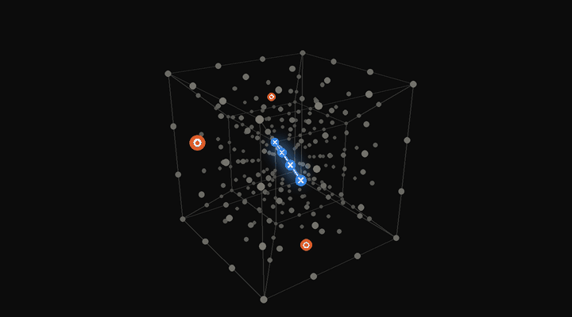
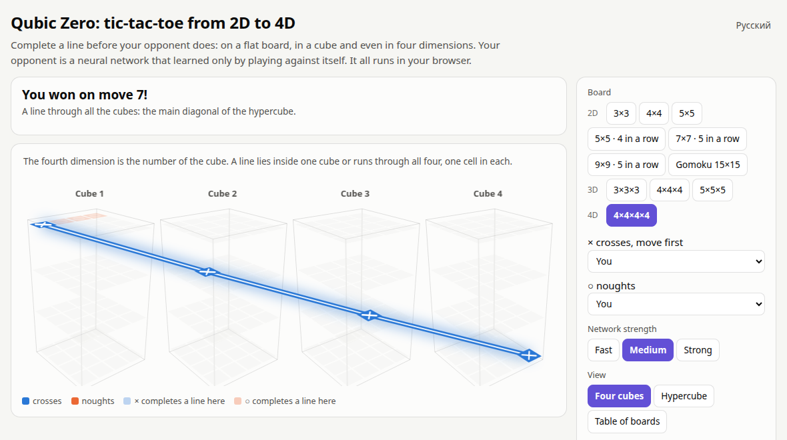
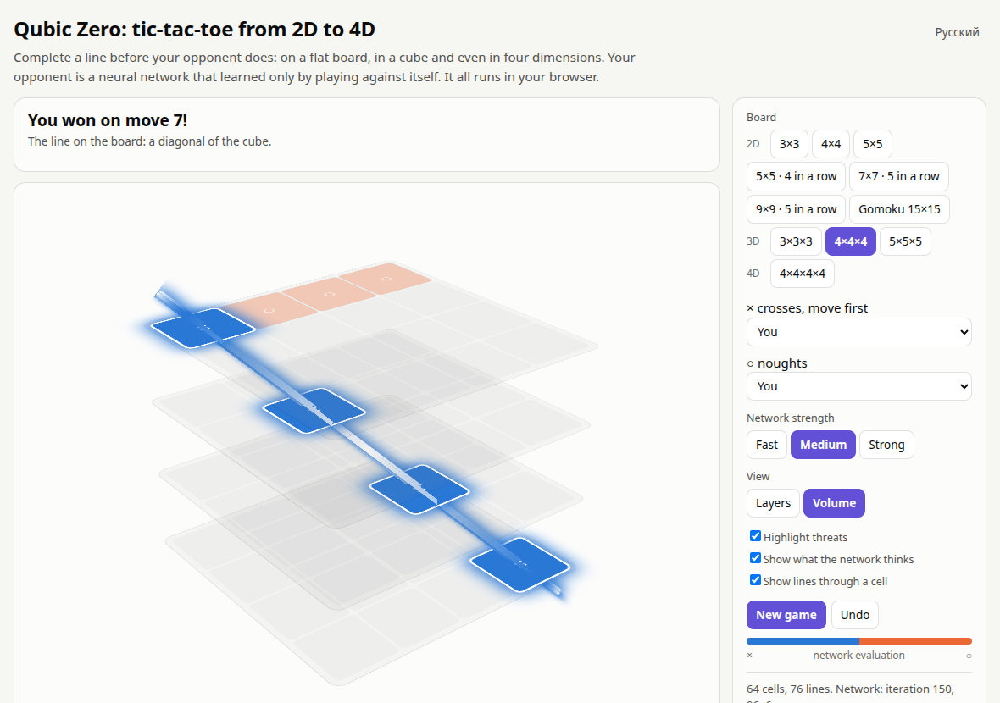
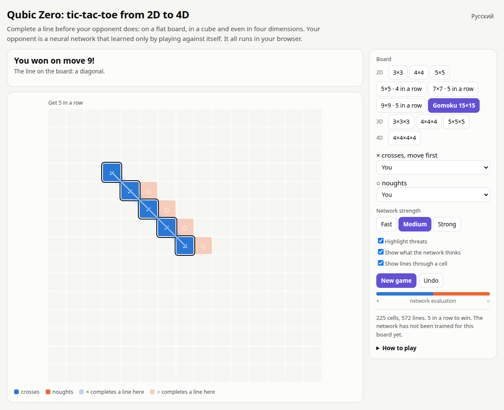
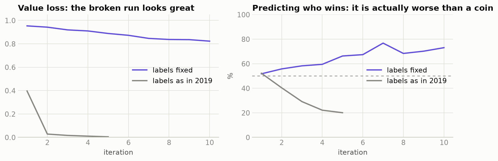
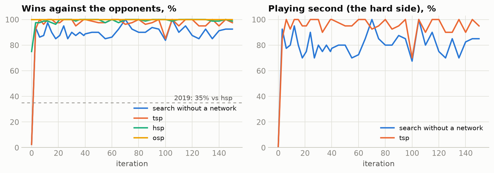
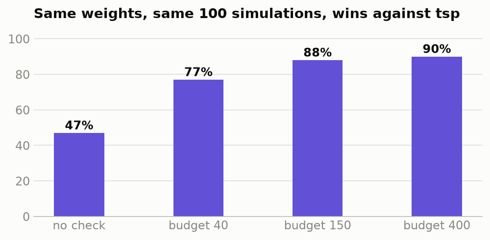
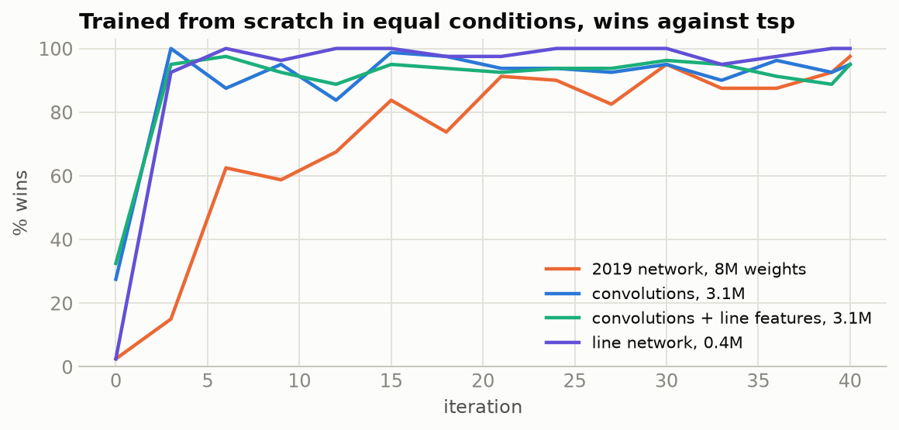
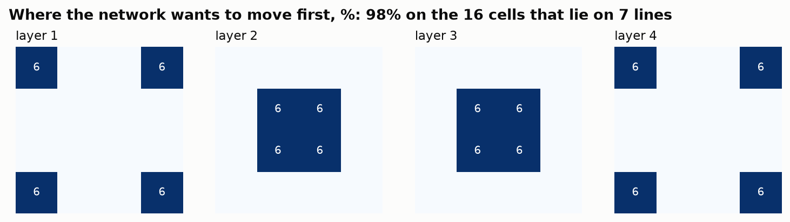
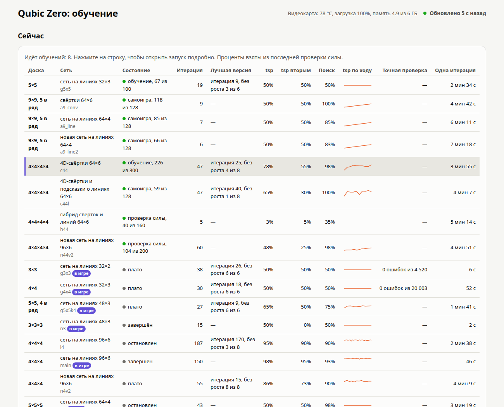

<div align="center">

# Qubic Zero

**Tic-tac-toe from 2D to 4D, against neural networks that taught themselves by self-play.**

[](https://ilyakz.github.io/alpha-game2/)

[](https://github.com/ilyakz/alpha-game2/actions/workflows/tests.yml)
[](LICENSE)


[Русская версия](README.ru.md)



*A real projection of the 4×4×4×4 board: 256 cells, 520 lines. Crosses have just won along the main diagonal of the hypercube.*

</div>

No installation: the network, the search and the rules all run right on the page. The hypercube spins in four dimensions, and you can play on it.

| | | |
|:-:|:-:|:-:|
|  |  |  |
| **4D:** the fourth dimension is the number of the cube | **3D:** the classic game Qubic | **2D:** from 3×3 up to gomoku |

## Contents

[The story](#the-story) · [What was wrong in 2019](#what-was-wrong-in-2019) · [Results](#results) · [Findings](#findings) · [Run it yourself](#run-it-yourself) · [How it works](#how-it-works) · [Credits](#credits)

## The story

In May 2019 I wrote an AlphaZero for 4×4×4 tic-tac-toe on Keras and TensorFlow 1. It never played well: 60% against a bot that moves randomly unless it can win or block, and 35% against a simple heuristic. I could not find out why. The [commit history](https://github.com/ilyakz/alpha-game2/commits/master/) of this repository still starts there, on 10 May 2019, and the code from that time is kept in [`legacy/`](legacy/).

Seven years later I came back to the code with one goal: find the error and finish the job. It turned out to be a single line, and the training data saved in 2019 proved it.

## What was wrong in 2019

The game returned the result from the point of view of the crosses, while the trainer expected it from the point of view of the current player:

```python
# framework/Coach.py expects "+1 if `player` won" and flips the sign for the other side
r = self.game.getGameEnded(board, self.curPlayer)
return [(x[0], x[2], r * ((-1) ** (x[1] != self.curPlayer))) for x in trainExamples]

# the game ignored `player`: +1 whenever crosses had a line, -1 whenever noughts had one
def getGameEnded(self, board, player): ...
```

Together this gives **-1 to every position of the crosses and +1 to every position of the noughts, no matter who won.** All 11,376 examples in the saved file are labelled exactly like that. The value network learned to tell whose turn it is, and the search trusted it.

What made it so hard to see: the loss looked wonderful. Whose turn it is can be read straight off the board, so the value loss fell almost to zero. I reproduced the bug in a control run:



The rules, the 76 winning lines, the 48 symmetries and the move indexing from 2019 were all correct: I checked them against brute force.

## Results

Every board has its own network, trained only on that board. On small boards the check is exact: a solver knows the true value of every position, so a mistake cannot hide.

| Board | In a row | Perfect play | How it was checked | Result |
|---|:-:|---|---|---|
| 3×3 | 3 | draw | solver, **every** one of the 4,520 possible positions | **0 mistakes** |
| 4×4 | 4 | draw | solver, every reply: 343,790 decisions, plus 20,003 random positions | **0 mistakes** |
| 5×5 | 5 | draw (see [below](#findings)) | matches against the bots | never lost, all draws against `tsp`, `hsp` and search only |
| 5×5 | 4 | | matches against the bots | never lost, 98–100% against weak bots |
| 3×3×3 | 3 | first player wins | solver, every reply: 372,613 decisions | **0 mistakes** |
| **4×4×4** | 4 | first player wins | matches of 300 games at 800 simulations | **100%** against `tsp`, 98.7% `hsp`, 90.8% search only |
| 5×5×5 | 5 | | matches of 60 games | 50% against `tsp`, all draws; 98.3% search only |
| 4×4×4×4 | 4 | | matches of 100 games | 13% against `tsp`, 95% search only. The hardest board, and the work on it continues |

7×7, 9×9 and gomoku can be played against the bots, and their networks are still in training.

**The opponents.** `osp` and `hsp` are the bots from 2019, which beat the old network. `tsp` is new: it searches for forced wins and avoids allowing them. "Search only" knows the same rules and threat sequences as the network but never learned anything. On 4×4×4 the first player is known to win with perfect play ([Patashnik, 1980](https://en.wikipedia.org/wiki/3D_tic-tac-toe)), so no network can always win as the second player against a perfect opponent.

Part of the strength comes from rules rather than learning: winning moves, forced blocks and threat sequences are found by a small C routine, not by the network. I kept that because it makes the network learn fast, but it means this is AlphaZero plus game knowledge, not pure AlphaZero.



## Findings

**A check inside the search gave the biggest jump.** With the same weights and the same 100 simulations, checking every new position for a forced win lifted the score against `tsp` from 47% to 90%. Moved to C, it even made the search faster, because the network is asked almost half as often.



**A small network built around the lines keeps up with convolutions on 4×4×4.** Instead of 3D convolutions, cells pass messages to the lines they lie on and back. With about 8 times fewer weights it scored 101–6–93 against the best convolutional network after 40 iterations each, and 98–11–91 after full training.



**The network found the best opening cells by itself.** Nobody told it which cells matter, yet it puts 98% of its first-move probability on the 8 corners and 8 central cells, which lie on 7 lines instead of 4.



**A bigger board can be an easier game.** 5×5×5 is twice as large as 4×4×4, yet games there fill 99% of the board and end in a draw. 4×4×4×4 is decided by forcing moves after about 14 moves on 256 cells. What changes is how many lines pass through a cell:

| Board | Cells | Lines through a cell | Board filled when decided | Self-play |
|---|---:|---:|---:|---|
| 4×4 | 16 | 2.5 | 100% | draws |
| 5×5×5 | 125 | 4.4 | 99% | 98% draws |
| 4×4×4 | 64 | 4.8 | 17% | first player wins 98% |
| 4×4×4×4 | 256 | 8.1 | 5% | first player wins almost always |

**The longest line is the dullest.** On 5×5 with five in a row there are only 12 lines. Each line can be given its own pair of cells, with no pair shared: 24 cells are enough, and the board has 25. Whenever the first player takes one cell of a pair, the second takes the other, so the first player can never complete a line. This proves a draw without any search. The same works on 6×6 and 7×7. A shorter line on a larger board is what makes the game interesting again.

**Two traps I fell into myself.**
- I read a value accuracy of 82% as proof that the network understands positions. Then I noticed it equals the share of first-player wins almost exactly: the network was mostly betting on the first player. Always compare with the simplest possible rule.
- On 3×3 my dashboard showed the network losing 14 of 20 games as the second player, which looked terrible. The cause was my check: matches started with two random moves, and the solver shows that in 48 of the 72 such openings the second player has already lost. From an empty board the same network drew 40 of 40.

**What did not help, measured in direct matches:** random openings in self-play (149–4–147), propagating proofs up the tree (52–48), making near wins worth more (96–6–98). A deeper search at play time helps only a little: 800 simulations instead of 100 lift the score against search without a network from 88% to 91%. The 2019 network itself was fine: with correct labels it learned to play well.

## Run it yourself

```bash
pip install -r requirements.txt     # also needs gcc, a small part of the rules is written in C
python play.py                      # the game at http://127.0.0.1:8766
python train.py --run my_run --arch linenet --channels 64 --blocks 4
python dashboard/server.py          # live charts at http://127.0.0.1:8765
python -m unittest discover -s tests && node tests/test_web.js
```

Other boards: `--n 5` for 5×5×5, `--n 4 --d 4` for 4×4×4×4, `--n 15 --d 2 --k 5` for gomoku. `tools/solve_small.py` runs the exact check on small boards, `compare.py` plays networks against each other.



## How it works

| File | What is inside |
|---|---|
| `qubic/game.py` | rules for any board size, dimension and line length: lines, symmetries, bitboards |
| `qubic/fast.c` | the part of the rules used on every search node: wins, threats, threat sequences |
| `qubic/mcts.py` | PUCT search; the leaves of all games go to the GPU in one batch |
| `qubic/net.py` | line networks, convolutions in 2D, 3D and 4D, and the 2019 network moved to PyTorch one to one |
| `qubic/play.py`, `qubic/worker.py` | self-play and matches in parallel processes |
| `qubic/bots.py` | the opponents |
| `train.py` | the training loop, with an automatic stop on a plateau |
| `dashboard/` | live dashboard: all runs at a glance, networks compared on one board, direct matches |
| `docs/` | the game: rules, search and network in plain JavaScript, checked against PyTorch to 1e-6 |
| `legacy/` | the code as it was in 2019 |

PyTorch has no 4D convolution, so `qubic/net.py` builds one out of 3D convolutions, and a test checks it against the definition cell by cell.

The search and the training loop follow AlphaZero. The main additions: the leaves are batched across all games, games stop as soon as a forced win is proven, and repeated positions are not evaluated twice.

## Credits

This project started from [alpha-zero-general](https://github.com/suragnair/alpha-zero-general) by Surag Nair and contributors: the 2019 code in `legacy/` is built on it. Everything else was written from scratch and is under the [MIT license](LICENSE). See [third-party notices](THIRD_PARTY_NOTICES.md) for the details.
