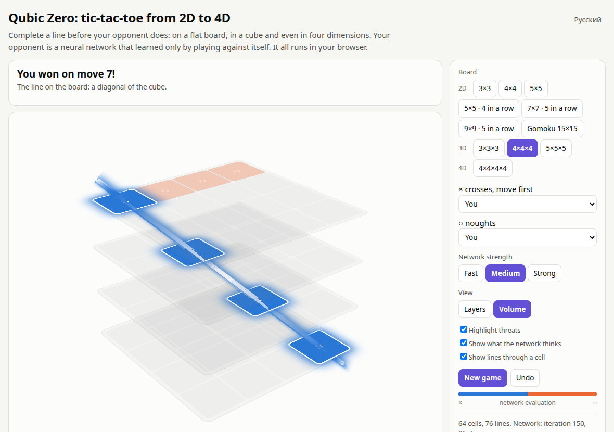
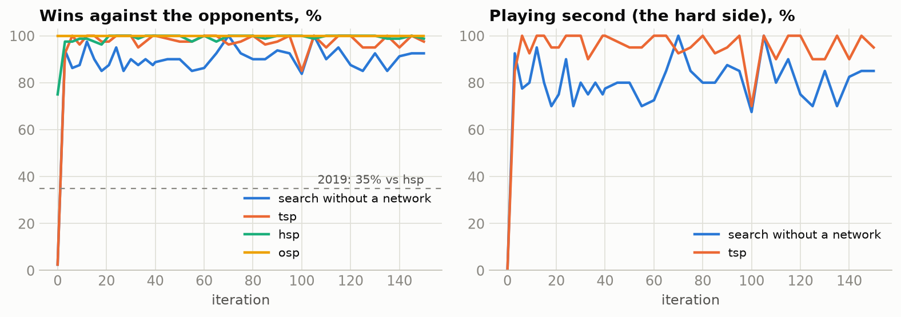
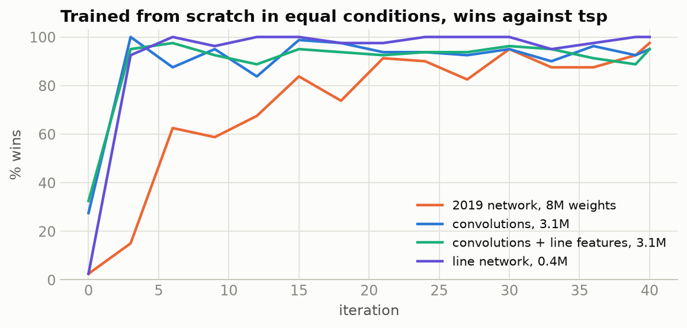
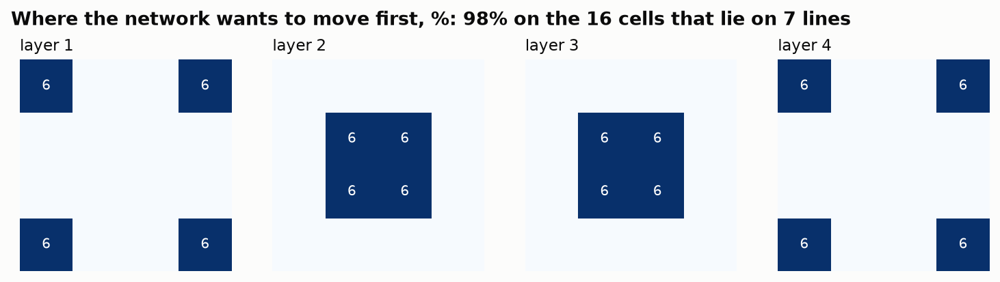

<div align="center">

# Qubic Zero

**Крестики-нолики от 2D до 4D против нейросетей, которые научились играть сами с собой.**

[](https://ilyakz.github.io/alpha-game2/)

[](https://github.com/ilyakz/alpha-game2/actions/workflows/tests.yml)
[](LICENSE)


[English version](README.md)


*Настоящая проекция доски 4×4×4×4: 256 клеток, 520 линий. Крестики только что выиграли по главной диагонали гиперкуба.*

</div>

Ничего устанавливать не нужно: сеть, поиск и правила работают прямо на странице. Гиперкуб вращается в четырёх измерениях, и на нём можно играть.

| | | |
|:-:|:-:|:-:|
|  |  |  |
| **4D:** четвёртое измерение это номер куба | **3D:** классическая игра Qubic | **2D:** от 3×3 до гомоку |

## Содержание

[История](#история) · [Что было не так в 2019 году](#что-было-не-так-в-2019-году) · [Результаты](#результаты) · [Находки](#находки) · [Запустить самому](#запустить-самому) · [Как это устроено](#как-это-устроено) · [Благодарности](#благодарности)

## История

В мае 2019 года я написал AlphaZero для крестиков-ноликов 4×4×4 на Keras и TensorFlow 1. Играла сеть плохо: 60% против бота, который ходит случайно, если не может выиграть или закрыть линию, и 35% против простой эвристики. Причину я тогда не нашёл. [История коммитов](https://github.com/ilyakz/alpha-game2/commits/master/) этого репозитория до сих пор начинается оттуда, с 10 мая 2019 года, а код того времени лежит в [`legacy/`](legacy/).

Через семь лет я вернулся к этому коду с одной целью: найти ошибку и довести работу до конца. Ошибка оказалась в одной строке, и обучающие данные, сохранённые в 2019 году, это доказали.

## Что было не так в 2019 году

Игра возвращала результат с точки зрения крестиков, а обучение ожидало его с точки зрения текущего игрока:

```python
# framework/Coach.py ждёт "+1, если выиграл player" и меняет знак для другой стороны
r = self.game.getGameEnded(board, self.curPlayer)
return [(x[0], x[2], r * ((-1) ** (x[1] != self.curPlayer))) for x in trainExamples]

# игра игнорировала player: +1, если линия у крестиков, -1, если у ноликов
def getGameEnded(self, board, player): ...
```

Вместе это даёт **-1 каждой позиции крестиков и +1 каждой позиции ноликов, кто бы ни выиграл.** Все 11 376 примеров в сохранённом файле размечены именно так. Сеть оценки научилась определять, чей сейчас ход, а поиск ей доверял.

Заметить это было трудно, потому что ошибка обучения выглядела прекрасно. Чей ход, видно прямо по доске, и ошибка оценки падала почти до нуля. Я воспроизвёл это в контрольном запуске:


Правила, 76 выигрышных линий, 48 симметрий и нумерация ходов в 2019 году были верными: я сверил их с полным перебором.

## Результаты

У каждой доски своя сеть, обученная только на ней. На маленьких досках проверка точная: решатель знает настоящую цену каждой позиции, поэтому ошибка не спрячется.

| Доска | В ряд | Идеальная игра | Как проверено | Результат |
|---|:-:|---|---|---|
| 3×3 | 3 | ничья | решатель, **каждая** из 4 520 возможных позиций | **0 ошибок** |
| 4×4 | 4 | ничья | решатель, все ответы: 343 790 решений, и ещё 20 003 случайные позиции | **0 ошибок** |
| 5×5 | 5 | ничья (см. [ниже](#находки)) | матчи с ботами | не проигрывала, все ничьи против `tsp`, `hsp` и поиска без сети |
| 5×5 | 4 | | матчи с ботами | не проигрывала, 98–100% против слабых ботов |
| 3×3×3 | 3 | выигрывает первый | решатель, все ответы: 372 613 решений | **0 ошибок** |
| **4×4×4** | 4 | выигрывает первый | матчи по 300 партий, 800 симуляций | **100%** против `tsp`, 98,7% `hsp`, 90,8% поиск без сети |
| 5×5×5 | 5 | | матчи по 60 партий | 50% против `tsp`, все ничьи; 98,3% поиск без сети |
| 4×4×4×4 | 4 | | матчи по 100 партий | 13% против `tsp`, 95% поиск без сети. Самая трудная доска, работа над ней продолжается |

На 7×7, 9×9 и в гомоку можно играть против ботов, их сети ещё обучаются.

**Соперники.** `osp` и `hsp` это боты 2019 года, которые обыгрывали старую сеть. `tsp` новый: он ищет форсированные выигрыши и не допускает чужих. «Поиск без сети» знает те же правила и серии шахов, но ничему не учился. На 4×4×4 при идеальной игре выигрывает первый игрок ([Patashnik, 1980](https://en.wikipedia.org/wiki/3D_tic-tac-toe)), поэтому никакая сеть не может всегда выигрывать вторым ходом у идеального соперника.

Часть силы даёт не обучение, а правила: выигрышные ходы, вынужденные ответы и серии шахов находит небольшая программа на C, а не сеть. Я оставил это, потому что так сеть учится быстрее, но значит это AlphaZero со знанием игры, а не чистый AlphaZero.



## Находки

**Самый большой скачок дала проверка внутри поиска.** С теми же весами и теми же 100 симуляциями проверка каждой новой позиции на форсированную победу подняла результат против `tsp` с 47% до 90%. После переноса на C поиск даже ускорился, потому что сеть вызывается почти вдвое реже.


**Маленькая сеть на линиях не уступает свёрткам на 4×4×4.** Вместо 3D-свёрток клетки обмениваются сообщениями с линиями, на которых лежат. При весах примерно в 8 раз меньше она сыграла 101–6–93 против лучшей свёрточной сети после 40 итераций и 98–11–91 после полного обучения.



**Сеть сама нашла лучшие клетки для первого хода.** Никто не говорил ей, какие клетки важны, но 98% вероятности первого хода она отдаёт 8 углам и 8 центральным клеткам, которые лежат на 7 линиях вместо 4.



**Доска побольше может оказаться игрой попроще.** 5×5×5 вдвое больше 4×4×4, но партии заполняют 99% доски и заканчиваются вничью. А 4×4×4×4 решается форсированными ходами примерно за 14 ходов на 256 клетках. Меняется то, сколько линий проходит через клетку:

| Доска | Клеток | Линий через клетку | Заполнено к развязке | Самоигра |
|---|---:|---:|---:|---|
| 4×4 | 16 | 2,5 | 100% | ничьи |
| 5×5×5 | 125 | 4,4 | 99% | ничьи 98% |
| 4×4×4 | 64 | 4,8 | 17% | первый выигрывает 98% |
| 4×4×4×4 | 256 | 8,1 | 5% | первый выигрывает почти всегда |

**Самая длинная линия самая скучная.** На 5×5 с пятью в ряд всего 12 линий. Каждой можно отдать свою пару клеток так, чтобы пары не пересекались: нужно 24 клетки, а на доске их 25. Как только первый игрок занимает одну клетку пары, второй занимает другую, и первый никогда не соберёт линию. Это доказательство ничьей, перебор тут даже не нужен. То же работает на 6×6 и 7×7. Интересной игру снова делает линия короче стороны доски.

**Две ловушки, в которые я попал сам.**
- Точность оценки 82% я принял за доказательство, что сеть понимает позиции. Потом заметил, что она почти точно равна доле побед первого игрока: сеть в основном ставила на первого. Сравнивать всегда надо с самым простым правилом.
- На 3×3 дашборд показывал, что сеть вторым ходом проигрывает 14 партий из 20, и выглядело это ужасно. Виновата была моя проверка: матчи начинались с двух случайных ходов, а решатель показывает, что в 48 из 72 таких начал второй игрок уже проиграл. С пустой доски та же сеть сыграла 40 ничьих из 40.

**Что не помогло, по прямым матчам:** случайные начала в самоигре (149–4–147), распространение доказательств по дереву (52–48), повышенная цена близкой победы (96–6–98). Более глубокий поиск при игре помогает мало: 800 симуляций вместо 100 поднимают результат против поиска без сети с 88% до 91%. Сама сеть 2019 года была в порядке: с верными метками она научилась хорошо играть.

## Запустить самому

```bash
pip install -r requirements.txt     # ещё нужен gcc: небольшая часть правил написана на C
python play.py                      # игра на http://127.0.0.1:8766
python train.py --run my_run --arch linenet --channels 64 --blocks 4
python dashboard/server.py          # живые графики на http://127.0.0.1:8765
python -m unittest discover -s tests && node tests/test_web.js
```

Другие доски: `--n 5` для 5×5×5, `--n 4 --d 4` для 4×4×4×4, `--n 15 --d 2 --k 5` для гомоку. `tools/solve_small.py` запускает точную проверку на маленьких досках, `compare.py` играет сетями друг против друга.


## Как это устроено

| Файл | Что внутри |
|---|---|
| `qubic/game.py` | правила для любого размера доски, размерности и длины линии: линии, симметрии, битовые доски |
| `qubic/fast.c` | часть правил, которая нужна на каждом узле поиска: победы, угрозы, серии шахов |
| `qubic/mcts.py` | поиск PUCT; листья всех партий идут на видеокарту одной пачкой |
| `qubic/net.py` | сети на линиях, свёртки в 2D, 3D и 4D и сеть 2019 года, перенесённая на PyTorch один в один |
| `qubic/play.py`, `qubic/worker.py` | самоигра и матчи в параллельных процессах |
| `qubic/bots.py` | соперники |
| `train.py` | цикл обучения с автоматической остановкой на плато |
| `dashboard/` | живой дашборд: все запуски сразу, сравнение сетей на одной доске, прямые матчи |
| `docs/` | игра: правила, поиск и сеть на чистом JavaScript, сверены с PyTorch до 1e-6 |
| `legacy/` | код в том виде, как он был в 2019 году |

В PyTorch нет четырёхмерной свёртки, поэтому `qubic/net.py` собирает её из трёхмерных, а тест сверяет её с определением по каждой клетке.

Поиск и цикл обучения следуют AlphaZero. Главные дополнения: листья собираются в пачку по всем партиям, партия останавливается, как только доказан форсированный выигрыш, а повторные позиции не считаются дважды.

## Благодарности

Проект вырос из [alpha-zero-general](https://github.com/suragnair/alpha-zero-general) Сурага Наира и соавторов: на нём построен код 2019 года в `legacy/`. Всё остальное написано с нуля и распространяется по [лицензии MIT](LICENSE). Подробнее в [файле о сторонних компонентах](THIRD_PARTY_NOTICES.md).
