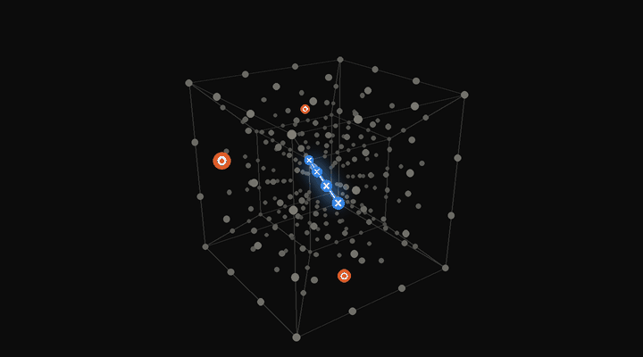
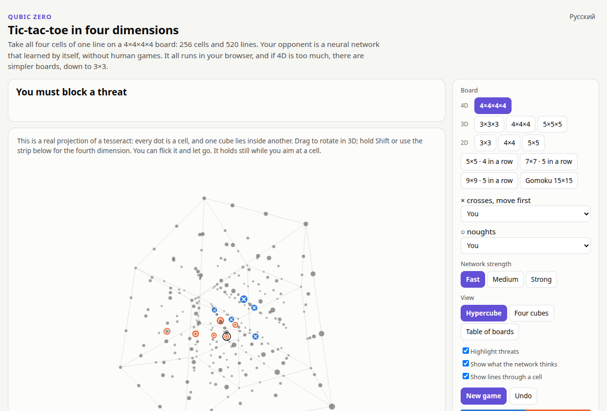
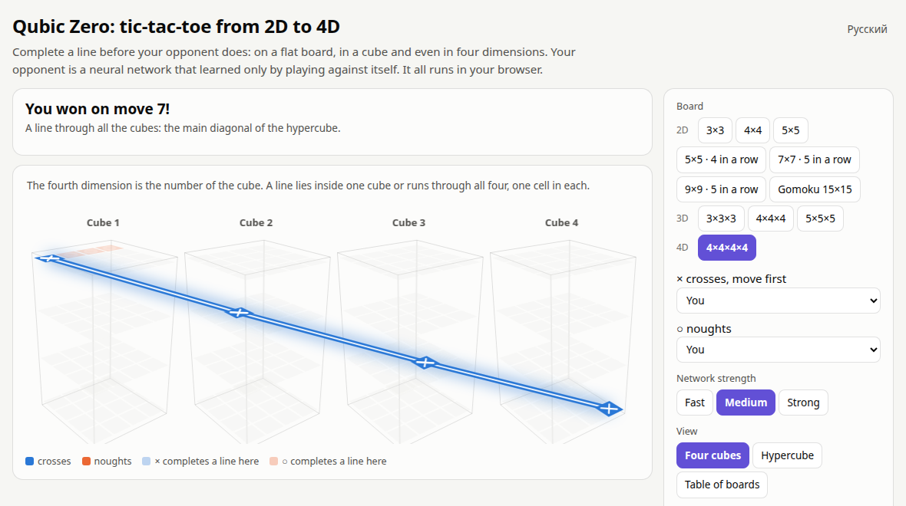
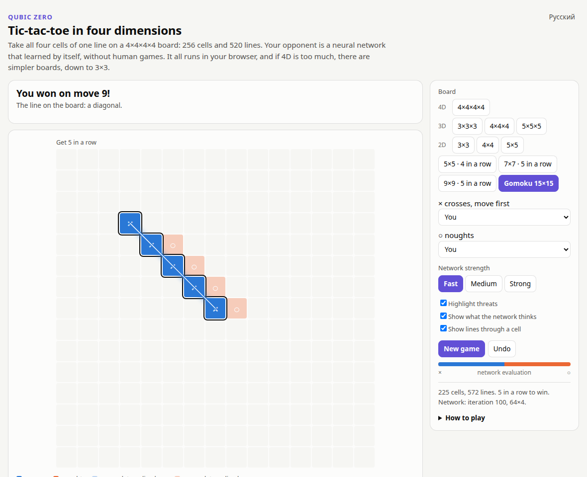
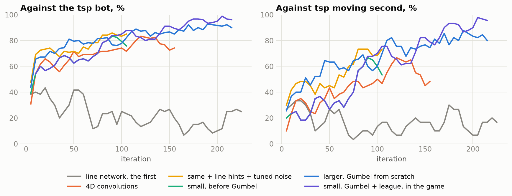
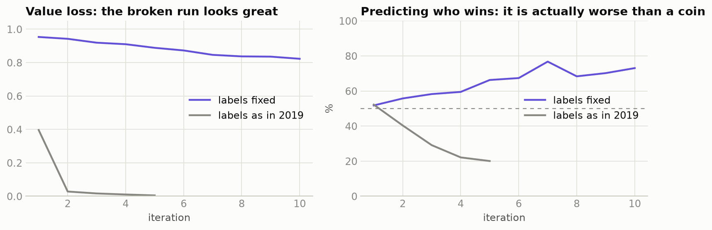
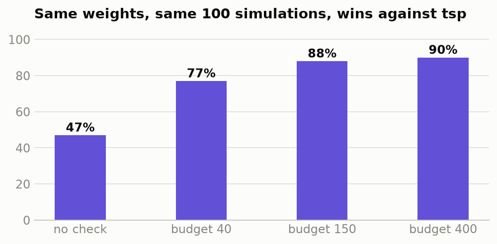
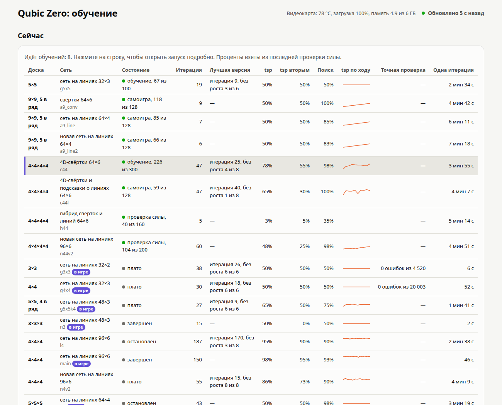

<div align="center">

# Qubic Zero

**Крестики-нолики в четырёх измерениях против нейросети, которая научилась играть сама.**

[](https://ilyakz.github.io/qubic-zero/)

[](https://github.com/ilyakz/qubic-zero/actions/workflows/tests.yml)
[](LICENSE)


[English version](README.md)



*Настоящая проекция доски 4×4×4×4: 256 клеток, 520 линий. Крестики только что выиграли по главной диагонали гиперкуба.*

</div>

Займите четыре клетки одной линии на доске 4×4×4×4 раньше, чем это сделает сеть. Ничего устанавливать не нужно: сеть, поиск и правила работают прямо на странице, а на обычном ноутбуке сеть отвечает за 2–5 секунд. Если 4D это слишком, есть доски попроще, от 3×3 до гомоку.

| | | |
|:-:|:-:|:-:|
|  |  |  |
| **Гиперкуб:** вращайте в четырёх измерениях | **Четыре куба:** номер куба это четвёртая координата | **Гомоку:** одна из одиннадцати досок |

## Содержание

[Игра в 4D](#игра-в-4d) · [Что было не так в 2019 году](#что-было-не-так-в-2019-году) · [Все доски](#все-доски) · [Находки](#находки) · [Запустить самому](#запустить-самому) · [Как это устроено](#как-это-устроено) · [Благодарности](#благодарности)

## Игра в 4D

Доска это четыре куба 4×4×4. Линия лежит внутри одного куба или идёт через все четыре, по одной клетке в каждом, а через клетку проходит до 15 линий. Угрозы возникают отовсюду, поэтому партия обычно решается примерно за 14 ходов, хотя клеток 256.

В сети, которая стоит в игре, 0,7 млн весов, а её файл весит 2,8 МБ. Вот как сыграли кандидаты, каждый на лучшем участке обучения, по 200 партий с каждым соперником и с теми же настройками, что в браузере:

| Сеть | Весов | Против `tsp` | Вторым ходом | Поиск без сети | Прямой матч с маленькой сетью |
|---|---:|---:|---:|---:|---:|
| **Маленькие 4D-свёртки и подсказки о линиях, в игре** | **0,7 млн** | **69%** | **38%** | **99%** | — |
| 4D-свёртки | 4,0 млн | 85,5% | 71% | 98% | 69–131 |
| 4D-свёртки, подсказки о линиях и настроенный шум | 4,0 млн | 78% | 60% | 99,5% | 88–112 |
| 4D-свёртки и подсказки о линиях | 4,0 млн | 73,5% | 47% | 99,5% | 72–128 |
| Новая сеть на линиях | 0,5 млн | 52% | 34% | 99% | не игран |
| Первая сеть на линиях | 0,1 млн | 13,5% | 2% | 93% | 47–153 |

Самая большая сеть сильнее всех против `tsp`, но маленькая обыгрывает её в прямом матче и отвечает примерно вчетверо быстрее. Поэтому в игре стоит именно она. На быстрой настройке (25 симуляций) она всё равно набирает 73% против `tsp`, в 100 партиях.

**Чего это не доказывает.** `tsp` был ещё и партнёром в половине обучающих партий, так что результаты против него могут быть завышены. В партиях сильных сетей первый игрок обычно выигрывает, поэтому настоящая проверка это игра вторым ходом, и даже лучший результат здесь 71%. Кто выигрывает на этой доске при идеальной игре, я не знаю. Другой сети в стиле AlphaZero, обученной на 4×4×4×4, я не нашёл, но поиск мог что-то упустить, поэтому называть проект первым не буду.



*Результаты проверок при обучении, среднее по трём проверкам. В каждой проверке всего 40 партий.*

**Соперники.** `osp` и `hsp` это боты 2019 года, которые обыгрывали старую сеть. `tsp` новый: он ищет форсированные выигрыши и не допускает чужих. «Поиск без сети» знает те же правила и серии шахов, но ничему не учился.

## История

В мае 2019 года я написал AlphaZero для крестиков-ноликов 4×4×4 на Keras и TensorFlow 1. Играла сеть плохо: 60% против бота, который ходит случайно, если не может выиграть или закрыть линию, и 35% против простой эвристики. Причину я тогда не нашёл. [История коммитов](https://github.com/ilyakz/qubic-zero/commits/master/) этого репозитория до сих пор начинается оттуда, с 10 мая 2019 года, а код того времени лежит в [`legacy/`](legacy/).

Через семь лет я вернулся к этому коду с одной целью: найти ошибку и довести работу до конца. Ошибка оказалась в одной строке, и обучающие данные, сохранённые в 2019 году, это доказали.

## Что было не так в 2019 году

Игра возвращала результат с точки зрения крестиков, а обучение ожидало его с точки зрения текущего игрока:

```python
# framework/Coach.py ждёт "+1, если выиграл player" и меняет знак для другой стороны
r = self.game.getGameEnded(board, self.curPlayer)
return [(x[0], x[2], r * ((-1) ** (x[1] != self.curPlayer))) for x in trainExamples]

# игра игнорировала player: +1, если линия у крестиков, -1, если у ноликов
def getGameEnded(self, board, player): ...
```

Вместе это даёт **-1 каждой позиции крестиков и +1 каждой позиции ноликов, кто бы ни выиграл.** Все 11 376 примеров в сохранённом файле размечены именно так. Сеть оценки научилась определять, чей сейчас ход, а поиск ей доверял.

Заметить это было трудно, потому что ошибка обучения выглядела прекрасно. Чей ход, видно прямо по доске, и ошибка оценки падала почти до нуля. Я воспроизвёл это в контрольном запуске:



Правила, 76 выигрышных линий, 48 симметрий и нумерация ходов в 2019 году были верными: я сверил их с полным перебором.

## Все доски

У каждой доски своя сеть, а её устройство выбирали прямые матчи. На маленьких досках проверка точная: решатель знает настоящую цену каждой позиции, поэтому ошибка не спрячется.

| Доска | В ряд | Идеальная игра | Сеть | Как проверено | Результат |
|---|:-:|---|---|---|---|
| **4×4×4×4** | 4 | мне неизвестно | 4D-свёртки 32×4 | 200 партий с каждым ботом | 69% `tsp`, 99% поиск без сети |
| 3×3 | 3 | ничья | линии 32×2 | решатель, **каждая** из 4 520 возможных позиций | **0 ошибок** |
| 4×4 | 4 | ничья | линии 32×3 | решатель, все ответы: 343 790 решений, и ещё 20 003 случайные позиции | **0 ошибок** |
| 5×5 | 5 | ничья, доказано [ниже](#находки) | линии 32×3 | 100 партий с каждым ботом | не проигрывала; ничьи с `tsp`, `hsp` и поиском без сети |
| 5×5 | 4 | мне неизвестно | линии 48×3 | 100 партий с каждым ботом | не проигрывала; 62,5% `tsp`, 75% поиск без сети |
| 7×7 | 5 | мне неизвестно | линии 64×4 | 100 партий с каждым ботом | не проигрывала; 58,5% `tsp`, 74% поиск без сети |
| 9×9 | 5 | мне неизвестно | линии 64×4 | 100 партий с каждым ботом | 100% против всех ботов |
| Гомоку 15×15 | 5 | выигрывает первый ([Allis, 1994](https://en.wikipedia.org/wiki/Gomoku)) | линии 64×4 | 100 партий с каждым ботом | 92,5% `tsp`, 100% поиск без сети |
| 3×3×3 | 3 | выигрывает первый | линии 48×3 | решатель, все ответы: 372 613 решений | **0 ошибок** |
| 4×4×4 | 4 | выигрывает первый ([Patashnik, 1980](https://en.wikipedia.org/wiki/3D_tic-tac-toe)) | линии 96×6 | 300 партий с каждым ботом, 800 симуляций | 100% `tsp`, 98,7% `hsp`, 90,8% поиск без сети |
| 5×5×5 | 5 | мне неизвестно | линии 64×4 | 60 партий с каждым ботом | ничьи с `tsp`, 98,3% поиск без сети |

**На 9×9 и в гомоку наши боты стали слишком слабыми, чтобы многое измерить.** Сто процентов значит, что сеть их обыгрывает, а не что она хорошо играет в гомоку. Серьёзный движок для гомоку был бы куда более трудной проверкой, и такой проверки я не проводил.

Часть силы даёт не обучение, а правила: выигрышные ходы, вынужденные ответы и серии шахов находит небольшая программа на C, а не сеть. Я оставил это, потому что так сеть учится быстрее, но значит это AlphaZero со знанием игры, а не чистый AlphaZero.

## Находки

**Универсальной сети нет.** На 4×4×4×4 свёртки обыграли сеть на линиях 153–47. На 9×9 вышло наоборот: сеть на линиях обыграла свёртки, которые в 3,5 раза больше, со счётом 48–18 и 134 ничьими. На 4×4×4 они равны, 98–11–91. Поэтому каждой доске сеть выбирали прямые матчи.

**Шум в поиске надо подбирать под доску.** Я оставил шум от маленьких досок, и на 256 ходах он был почти равномерным. С шумом под число ходов и более долгим случайным началом партии та же сеть набрала 78% вместо 73,5% против `tsp` и 60% вместо 47% вторым ходом. И пришла к этому за намного меньшее число итераций.

**Меньший шаг обучения окупился не сразу.** Свёртки десятки итераций держались около 70% против `tsp`, а после ещё одного снижения шага дошли примерно до 80%. Остановка на первом плато это бы упустила, поэтому правило плато теперь сначала снижает шаг.

**Самый большой скачок дала проверка внутри поиска.** С теми же весами и теми же 100 симуляциями проверка каждой новой позиции на форсированную победу подняла результат против `tsp` с 47% до 90%. После переноса на C поиск даже ускорился, потому что сеть вызывается почти вдвое реже.



**Проверка в корне делает разницу заметной.** Когда ходов больше, чем симуляций, поиск не успевает посмотреть каждый ход, поэтому проверка убирает ходы, отдающие форсированную победу. Без неё прямые матчи 4D-сетей были почти равными, а с ней новые сети обыграли старую 153–47.

**Доска побольше может оказаться игрой попроще.** 5×5×5 вдвое больше 4×4×4, но партии заполняют 99% доски и заканчиваются вничью. Похоже, важно то, сколько линий проходит через клетку:

| Доска | Клеток | Линий через клетку | Заполнено к развязке | Самоигра |
|---|---:|---:|---:|---|
| 4×4 | 16 | 2,5 | 100% | ничьи |
| 5×5×5 | 125 | 4,4 | 99% | ничьи 98% |
| 4×4×4 | 64 | 4,8 | 17% | первый выигрывает 98% |
| 4×4×4×4 | 256 | 8,1 | 5% | первый выигрывает почти всегда |

**Самая длинная линия самая скучная.** На 5×5 с пятью в ряд всего 12 линий. Каждой можно отдать свою пару клеток так, чтобы пары не пересекались: нужно 24 клетки, а на доске их 25. Как только первый игрок занимает одну клетку пары, второй занимает другую, и первый никогда не соберёт линию. Это доказательство ничьей, перебор тут даже не нужен. То же работает на 6×6 и 7×7. Интересной игру снова делает линия короче стороны доски.

**Две ловушки, в которые я попал сам.**
- Точность оценки 82% я принял за доказательство, что сеть понимает позиции. Потом заметил, что она почти точно равна доле побед первого игрока: сеть в основном ставила на первого. Сравнивать всегда надо с самым простым правилом.
- На 3×3 дашборд показывал, что сеть вторым ходом проигрывает 14 партий из 20, и выглядело это ужасно. Виновата была моя проверка: матчи начинались с двух случайных ходов, а решатель показывает, что в 48 из 72 таких начал второй игрок уже проиграл. С пустой доски та же сеть сыграла 40 ничьих из 40.

**Что не помогло, по прямым матчам:** случайные начала в самоигре (149–4–147), распространение доказательств по дереву (52–48), повышенная цена близкой победы (96–6–98). Гибрид, передающий сообщения по линиям в каждом свёрточном блоке, за 30 итераций набрал лишь 18% против `tsp`, и я остановил его раньше. Более глубокий поиск при игре помогает мало: на 4×4×4×4 рост со 100 до 1600 симуляций добавил около 10 пунктов против `tsp`, а больший бюджет серий шахов не добавил ничего.

## Запустить самому

```bash
pip install -r requirements.txt     # ещё нужен gcc: небольшая часть правил написана на C
python play.py                      # игра на http://127.0.0.1:8766
python train.py --run my_run --n 4 --d 4 --arch conv4d_lines --channels 32 --blocks 4 --league tsp=0.5 --noise-alpha 0.04 --temperature-plies 12 --patience 6 --lr-drops 2
python dashboard/server.py          # живые графики на http://127.0.0.1:8765
python -m unittest discover -s tests && node tests/test_web.js
```

Другие доски: `--n 4 --d 3` для 4×4×4, `--n 15 --d 2 --k 5` для гомоку. `tools/solve_small.py` запускает точную проверку на маленьких досках, `compare.py` играет сетями друг против друга, `tools/final_match.py` играет ими против ботов.

Дашборд показывает все запуски сразу, сравнивает сети на одной доске и следит за нагрузкой на машину.



## Как это устроено

| Файл | Что внутри |
|---|---|
| `qubic/game.py` | правила для любого размера доски, размерности и длины линии: линии, симметрии, битовые доски |
| `qubic/fast.c` | часть правил, которая нужна на каждом узле поиска: победы, угрозы, серии шахов |
| `qubic/mcts.py` | поиск PUCT; листья всех партий идут на видеокарту одной пачкой |
| `qubic/net.py` | сети на линиях, свёртки в 2D, 3D и 4D и сеть 2019 года, перенесённая на PyTorch один в один |
| `qubic/play.py`, `qubic/worker.py` | самоигра и матчи в параллельных процессах |
| `qubic/bots.py` | соперники |
| `train.py` | цикл обучения: партии с ботами, снижение шага на плато, затем автоматическая остановка |
| `dashboard/` | живой дашборд на двух языках |
| `docs/` | игра: правила, поиск и сети на чистом JavaScript, сверены с PyTorch до 1e-6 |
| `legacy/` | код в том виде, как он был в 2019 году |

В PyTorch нет четырёхмерной свёртки, поэтому `qubic/net.py` собирает её из трёхмерных, а тест сверяет её с определением по каждой клетке.

Поиск и цикл обучения следуют AlphaZero. Главные дополнения: листья собираются в пачку по всем партиям, партия останавливается, как только доказан форсированный выигрыш, а повторные позиции не считаются дважды.

## Благодарности

Проект вырос из [alpha-zero-general](https://github.com/suragnair/alpha-zero-general) Сурага Наира и соавторов: на нём построен код 2019 года в `legacy/`. Всё остальное написано с нуля и распространяется по [лицензии MIT](LICENSE). Подробнее в [файле о сторонних компонентах](THIRD_PARTY_NOTICES.md).

Спасибо [Anthropic](https://www.anthropic.com) и [Claude Code](https://claude.com/claude-code) с моделью Claude Opus 5.5: они помогли мне закончить эту старую работу и получить такие результаты.
